# Banco de dados — Moura Center

PostgreSQL 17 com Prisma ORM 7.10.1. O schema é carregado pela pasta `prisma/`, conforme `prisma7.config.ts`. Os arquivos de models definem a estrutura; não são dados de exemplo.

## Organização

| Arquivo em `prisma/models/` | Responsabilidade |
| --- | --- |
| `identity.prisma` | Usuários, papéis, autenticação compatível com Auth.js e endereços |
| `catalog.prisma` | Produtos, variantes/SKUs, imagens, categorias, favoritos e avaliações |
| `cart.prisma` | Carrinhos de clientes ou visitantes e seus itens |
| `inventory.prisma` | Saldo, reservas e histórico de movimentações por SKU |
| `sales.prisma` | Pedidos, itens, endereço da compra, tentativas de pagamento e entregas |
| `storefront.prisma` | Coleções ordenadas (novidades, mais vendidos, kits) e banners |
| `administation.prisma` | Configurações da loja e registros de auditoria |

## Decisões e integridade

- Modelo de uma loja. O nome do repositório não implica isolamento entre múltiplas lojas.
- Produtos têm ao menos uma variante por regra da aplicação, mesmo sem tamanho/cor. Preços ficam no SKU e usam `Decimal(12,2)`, em BRL; valores não devem ser calculados com ponto flutuante.
- Categorias possuem hierarquia; produtos podem pertencer a várias categorias e coleções. Kits são produtos vendáveis com SKU próprio e estoque próprio, sem composição automática de estoque.
- Nota e quantidade de avaliações são agregadas de `Review` publicado; não se criam avaliações fictícias para reproduzir as notas da vitrine.
- Pedidos preservam nome, SKU, preço, contato e endereço do checkout. Alterações posteriores no cadastro não mudam essas cópias. Produtos vendidos devem ser arquivados, pois a exclusão de seus SKUs é restrita.
- Visitantes usam `guestToken` aleatório; pedidos podem não ter usuário. Um carrinho converte em no máximo um pedido. A migração limita a um carrinho ativo por usuário e um endereço padrão por usuário.
- Disponível = `Inventory.quantity - Inventory.reserved`. A aplicação deve reservar, baixar estoque, registrar movimentações e atualizar pedidos em transações com controle de concorrência. O carrinho não reserva estoque automaticamente.
- Pagamentos guardam referências do provedor e chave de idempotência, sem dados de cartão. Estornos parciais e devoluções detalhadas precisam de modelagem adicional.
- A migração SQL acrescenta `CHECK`s para notas de 1 a 5, quantidades, valores, totais e datas de banners. Essas regras e os índices parciais devem ser preservados em migrações futuras; não são representados integralmente pelo schema Prisma.
- A aplicação deve validar ciclos de categorias, transições de status, soma dos itens/pagamentos, vínculo do carrinho ao comprador, autorização por papel e conteúdo da auditoria. O schema não implementa esses fluxos.
- Configurações usam o registro de ID `default` por convenção. Segredos de integrações ficam nas variáveis de ambiente.

## Uso local

Configure `.env` a partir de `.env.example`, mantendo as credenciais e a URL consistentes. Execute:

```sh
npm run db:up
npm run db:validate
npx prisma migrate deploy --config prisma7.config.ts
npm run db:generate
```

Para futuras alterações, use `npm run db:migrate -- --name nome_da_alteracao`. A migração inicial cria as tabelas, índices, chaves estrangeiras e restrições. Não inclui seed nem conecta os componentes da vitrine ao banco: a página ainda utiliza `app/(public)/_data/products.ts`.

## Diagrama completo

Fonte independente: [database.mmd](./database.mmd). As entidades correspondem aos models Prisma; `@@map` define os nomes físicos das tabelas. Marcadores indicam relações obrigatórias/opcionais e cardinalidade. Regras como “ao menos uma variante por produto” são responsabilidade da aplicação.

```mermaid
erDiagram
  StoreSettings {
    String id PK
    String name
    String supportEmail
    String supportPhone
    String whatsapp
    String instagramUrl
    Decimal freeShippingThreshold
    DateTime updatedAt
  }
  AuditLog {
    String id PK
    String actorId
    String action
    String entity
    String entityId
    Json metadata
    DateTime createdAt
  }
  Cart {
    String id PK
    String userId
    String guestToken UK
    CartStatus status
    DateTime expiresAt
    DateTime createdAt
    DateTime updatedAt
  }
  CartItem {
    String id PK
    String cartId
    String variantId
    Int quantity
    DateTime createdAt
    DateTime updatedAt
  }
  Category {
    String id PK
    String name
    String slug UK
    String description
    String illustration
    String parentId
    Int position
    Boolean isActive
  }
  Product {
    String id PK
    String name
    String slug UK
    String description
    ProductStatus status
    String badge
    DateTime createdAt
    DateTime updatedAt
  }
  ProductVariant {
    String id PK
    String productId
    String sku UK
    String name
    String size
    String color
    Decimal price
    Decimal originalPrice
    Int weightGrams
    Boolean isActive
    DateTime createdAt
    DateTime updatedAt
  }
  ProductImage {
    String id PK
    String productId
    String url
    String alt
    Int position
  }
  ProductCategory {
    String productId
    String categoryId
  }
  Favorite {
    String userId
    String productId
    DateTime createdAt
  }
  Review {
    String id PK
    String userId
    String productId
    Int rating
    String comment
    Boolean isPublished
    DateTime createdAt
    DateTime updatedAt
  }
  Account {
    String id PK
    String userId
    String type
    String provider
    String providerAccountId
    String refresh_token
    String access_token
    Int expires_at
    String token_type
    String scope
    String id_token
    String session_state
  }
  Session {
    String id PK
    String sessionToken UK
    String userId
    DateTime expires
  }
  User {
    String id PK
    String name
    String email UK
    DateTime emailVerified
    String image
    String phone
    UserRole role
    DateTime createdAt
    DateTime updatedAt
  }
  VerificationToken {
    String identifier
    String token
    DateTime expires
  }
  Address {
    String id PK
    String userId
    String label
    String recipient
    String phone
    String postalCode
    String street
    String number
    String complement
    String district
    String city
    String state
    String country
    Boolean isDefault
    DateTime createdAt
    DateTime updatedAt
  }
  Inventory {
    String id PK
    String variantId UK
    Int quantity
    Int reserved
    Int minimumQuantity
    DateTime updatedAt
  }
  StockMovement {
    String id PK
    String inventoryId
    String orderId
    StockMovementType type
    Int quantity
    String reason
    DateTime createdAt
  }
  Order {
    String id PK
    Int number UK
    String userId
    String cartId UK
    OrderStatus status
    String customerName
    String customerEmail
    String customerPhone
    String currency
    Decimal subtotal
    Decimal discountTotal
    Decimal shippingTotal
    Decimal total
    String notes
    DateTime createdAt
    DateTime updatedAt
  }
  OrderItem {
    String id PK
    String orderId
    String variantId
    String productName
    String variantName
    String sku
    Int quantity
    Decimal unitPrice
    Decimal discountTotal
    Decimal total
  }
  OrderAddress {
    String id PK
    String orderId UK
    String recipient
    String phone
    String postalCode
    String street
    String number
    String complement
    String district
    String city
    String state
    String country
  }
  Payment {
    String id PK
    String orderId
    PaymentMethod method
    PaymentStatus status
    String provider
    String externalId
    String idempotencyKey UK
    Decimal amount
    DateTime paidAt
    DateTime createdAt
    DateTime updatedAt
  }
  Shipment {
    String id PK
    String orderId
    String carrier
    String service
    String trackingCode
    String trackingUrl
    DateTime shippedAt
    DateTime deliveredAt
    DateTime createdAt
    DateTime updatedAt
  }
  Collection {
    String id PK
    String slug UK
    String title
    String description
    Int position
    Boolean isActive
  }
  CollectionProduct {
    String collectionId
    String productId
    Int position
  }
  Banner {
    String id PK
    String title
    String subtitle
    String imageUrl
    String imageAlt
    String linkUrl
    Int position
    Boolean isActive
    DateTime startsAt
    DateTime endsAt
    DateTime createdAt
    DateTime updatedAt
  }
  User |o--o{ AuditLog : actor
  User |o--o{ Cart : user
  Cart ||--o{ CartItem : cart
  ProductVariant ||--o{ CartItem : variant
  Category |o--o{ Category : parent
  Product ||--o{ ProductVariant : product
  Product ||--o{ ProductImage : product
  Product ||--o{ ProductCategory : product
  Category ||--o{ ProductCategory : category
  User ||--o{ Favorite : user
  Product ||--o{ Favorite : product
  User ||--o{ Review : user
  Product ||--o{ Review : product
  User ||--o{ Account : user
  User ||--o{ Session : user
  User ||--o{ Address : user
  ProductVariant ||--o| Inventory : variant
  Inventory ||--o{ StockMovement : inventory
  Order |o--o{ StockMovement : order
  User |o--o{ Order : user
  Cart |o--o| Order : cart
  Order ||--o{ OrderItem : order
  ProductVariant ||--o{ OrderItem : variant
  Order ||--o| OrderAddress : order
  Order ||--o{ Payment : order
  Order ||--o{ Shipment : order
  Collection ||--o{ CollectionProduct : collection
  Product ||--o{ CollectionProduct : product
```


